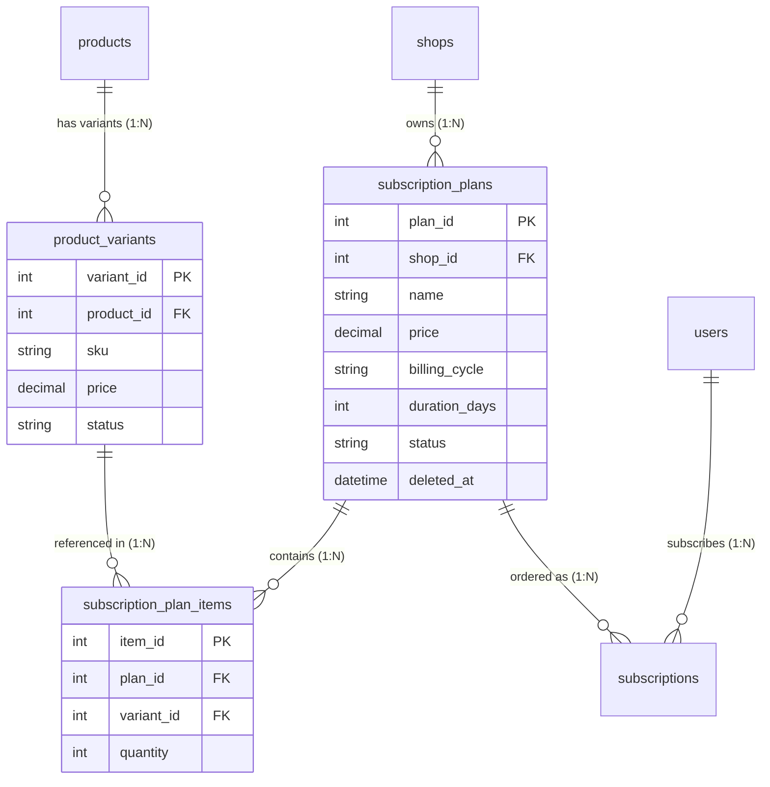

# TỔNG HỢP KIẾN TRÚC & TÍNH NĂNG HỆ THỐNG SUBSCRIPTION (GÓI ĐĂNG KÝ ĐỊNH KỲ)
**Dự án:** Online Fruit Shopping Platform (SWP391_SE2063_Group4)  
**Tài liệu:** Báo cáo tổng hợp thay đổi kỹ thuật và nghiệp vụ  

---

## 1. TÁI CẤU TRÚC NGHIỆP VỤ & PHÂN QUYỀN (MULTI-VENDOR PLATFORM)

### 1.1. Chuyển quyền quản trị gói về Shop Owner
- **Bối cảnh:** Trước đây hệ thống thiết kế theo hướng Admin tạo gói tập trung. Tuy nhiên, do nền tảng là sàn thương mại điện tử đa nhà cung cấp (Multi-vendor), mỗi chủ shop (`Shop Owner`) phải có quyền tự thiết kế các gói combo trái cây riêng dựa trên nguồn hàng của họ.
- **Quy tắc phân quyền:**
  - **Shop Owner:** Tạo, chỉnh sửa, bật/tắt (Active/Inactive), xem danh sách và xóa (soft-delete) các gói đăng ký định kỳ của cửa hàng mình.
  - **Khách hàng thông thường:** Xem và đăng ký các gói Combo có sẵn do các shop phát hành.
  - **Khách hàng Hội viên (`is_member = 1`):** Có thêm quyền tự chọn trái cây để cấu hình **Gói định kỳ tùy chỉnh (Custom Subscription)**.

---

## 2. THIẾT KẾ CƠ SỞ DỮ LIỆU & QUAN HỆ SẢN PHẨM (DATABASE SCHEMA)

### 2.1. Ràng buộc giữa Gói Đăng Ký và Biến Thể Sản Phẩm (Product Variants)
Mỗi loại trái cây có nhiều biến thể (kích cỡ, trọng lượng hộp, phân loại). Gói đăng ký combo bắt buộc phải liên kết trực tiếp với các **Product Variants** cụ thể thông qua bảng trung gian `subscription_plan_items`.

#### Sơ đồ thực thể ERD:

#### Chi tiết bảng cơ sở dữ liệu:
1. **`subscription_plans`**:
   - `plan_id` (PK, IDENTITY), `shop_id` (FK), `name`, `description`, `price`, `billing_cycle`, `duration_days`, `benefits`, `status`, `created_by`, `created_at`, `updated_at`, `deleted_at`.
   - `status`: Hỗ trợ 3 trạng thái `draft` (Bản nháp), `active` (Đang kinh doanh), `inactive` (Tạm dừng).
   - `deleted_at`: Quản lý xóa mềm (Soft-delete).
2. **`subscription_plan_items`**:
   - `item_id` (PK, IDENTITY), `plan_id` (FK ON DELETE CASCADE), `variant_id` (FK), `quantity` (CHECK `quantity > 0`).
   - Ràng buộc duy nhất `UQ_Plan_Variant(plan_id, variant_id)` ngăn trùng lặp cùng 1 biến thể trong một gói.
3. **`subscriptions`**:
   - `subscription_id`, `user_id`, `plan_id`, `shop_id`, `frequency`, `next_delivery_date`, `end_date`, `price_snapshot`, `status`, `notes`.

---

## 3. LOGIC XỬ LÝ BACKEND (JAVA EE / SERVICE & DAO)

### 3.1. Xác thực nghiêm ngặt danh sách biến thể (`validatePlanItems`)
Trong `SubscriptionService.java`:
- **Bắt buộc có sản phẩm:** Gói combo phải chứa ít nhất 1 biến thể sản phẩm (`items != null && !items.isEmpty()`).
- **Số lượng hợp lệ:** Kiểm tra `quantity > 0`.
- **Chống trùng lặp (Deduplication):** Sử dụng `Set<Integer>` để chặn việc submit cùng 1 `variant_id` nhiều lần.
- **Bảo mật đa nhà cung cấp (Multi-tenant check):** Toàn bộ `variant_id` gửi lên phải thuộc về các sản phẩm đang `active`/`published` của chính `shop_id` đó (`planDAO.getAvailableVariantsByShop(shopId)`), ngăn chặn việc shop này chèn trái phép sản phẩm của shop khác.

### 3.2. Tính nguyên vẹn khi Tạo / Sửa gói (Atomic Transaction)
- **Tạo gói (`createPlan`):** Xác thực thông tin gói và items $\rightarrow$ Tạo record `subscription_plans` $\rightarrow$ Thêm các items vào `subscription_plan_items`. Nếu thêm items thất bại, hệ thống tự động dọn dẹp bằng `softDeletePlan(newId)` để tránh tình trạng "gói rác không có sản phẩm".
- **Cập nhật gói (`updatePlan`):** Kiểm tra quyền sở hữu shop $\rightarrow$ Cập nhật thông tin gói $\rightarrow$ Xóa items cũ và chèn lại bộ items mới trong cùng luồng thao tác.

### 3.3. Đồng bộ và ràng buộc Chu kỳ (`billing_cycle`) với Thời hạn (`duration_days`)
Đã khắc phục lỗi bất hợp lý logic (chu kỳ hàng tuần nhưng thời hạn lại để 30 ngày):
- **Quy tắc bắt buộc tại Backend:**
  - `weekly` (Hàng tuần) $\rightarrow$ Bắt buộc `durationDays == 7`.
  - `monthly` (Hàng tháng) $\rightarrow$ Thời hạn `durationDays` là 30 ngày (cho phép linh hoạt 28–31 ngày).
  - `quarterly` (Hàng quý) $\rightarrow$ Thời hạn `durationDays` là 90 ngày (89–93 ngày).
  - `yearly` (Hàng năm) $\rightarrow$ Thời hạn `durationDays` là 365 ngày.
- **Tự động suy luận:** Trong `ShopOwnerPlanServlet.java`, nếu `durationDays <= 0`, hệ thống tự động gán số ngày chuẩn theo chu kỳ.
- **Giữ nguyên trạng thái khi lỗi:** Nếu tạo gói không hợp lệ, Servlet nạp lại `plan.setItems(items)` để không làm mất danh sách sản phẩm người dùng vừa chọn khi form hiển thị lại.

### 3.4. Cơ chế Xóa mềm & Bảo vệ Thuê bao Đang hoạt động
- Không cho phép xóa gói nếu đang có khách hàng sử dụng (`countActiveSubscribers(planId) > 0`).
- Khi xóa, cập nhật `deleted_at = GETDATE()` và `status = 'inactive'`, giữ nguyên vẹn lịch sử giao dịch và đơn định kỳ cho khách hàng cũ.

---

## 4. GIAO DIỆN NGƯỜI DÙNG & TỐI ƯU TRẢI NGHIỆM (JSP / CSS / JAVASCRIPT)

### 4.1. Khắc phục lỗi Bind dữ liệu JSP EL trên Form tạo gói
- **Vấn đề đã xử lý:** Trước đây cú pháp `${v.variantId}` trong thẻ `<script>` bị Tomcat JSP Expression Language hiểu nhầm thành biến server và render ra `value=""` cùng `data-price=""`. Điều này khiến thành tiền hiển thị là **0 đ** và khi ấn submit bị server chặn lại với thông báo *"Gói đăng ký định kỳ phải chứa ít nhất 1 biến thể sản phẩm"*.
- **Giải pháp:** Chuyển sang nối chuỗi JavaScript thuần túy (`'<option value="' + v.variantId + '" data-price="' + v.unitPrice + '">...'`), loại bỏ 100% xung đột JSP EL.

### 4.2. Thanh tìm kiếm nhanh sản phẩm (Quick Search & Autocomplete)
Tại `planForm.jsp`:
- Tích hợp thanh tìm kiếm tức thì theo tên trái cây hoặc mã SKU (ví dụ: *Nho*, *Táo Fuji*, *1kg*...).
- Menu gợi ý thông minh với trạng thái giá, hiển thị nút `+ Thêm` tiện lợi.
- Khi bấm chọn một sản phẩm đã có trong combo, hệ thống tự động **tăng số lượng lên 1** và chớp sáng viền xanh báo hiệu, không bắt người dùng phải cuộn danh sách chọn thủ công.

### 4.3. Bảng tính toán giá trị Combo trực quan
- Tự động cộng tổng giá gốc lẻ của từng món: $\text{Tổng gốc} = \sum (\text{Đơn giá} \times \text{Số lượng})$.
- So sánh tức thì với **Giá bán gói** để hiển thị số tiền và tỷ lệ phần trăm tiết kiệm cho khách hàng (ví dụ: *Tiết kiệm 50.000 đ (25%)*).
- Tự động đổi số ngày hiệu lực trên form ngay khi người dùng chuyển đổi giữa các chu kỳ thanh toán (Tuần $\rightarrow$ 7 ngày, Tháng $\rightarrow$ 30 ngày...).

### 4.4. Mở rộng tùy chọn giao hàng tại trang Checkout (`subscribeCheckout.jsp`)
Bổ sung các trường thông tin phục vụ dịch vụ giao trái cây định kỳ:
- Lựa chọn khung giờ nhận hàng trong ngày (`deliveryTimeSlot`: Sáng 8h-11h, Chiều 14h-17h, Tối 18h-20h).
- Tùy chọn độ chín mong muốn (`ripenessPreference`: Ăn ngay trong ngày, Vừa chín tới ăn cả tuần, Chín từ từ...).
- Ghi chú sở thích/dị ứng trái cây (`fruitPreferences`).
- Số điện thoại phụ dự phòng (`backupPhone`).
- Sửa lỗi 500 JSP khi hiển thị danh sách địa chỉ nhận hàng của khách.
