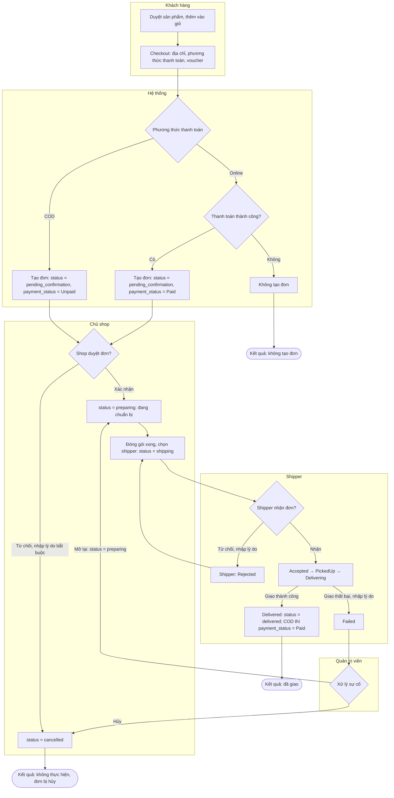

# Sơ đồ hoạt động: Đặt hàng và xử lý đơn

Sơ đồ này bám theo code hiện tại (`OrderDAO`, `StoreOwnerOrderServlet`, `DeliveryRules`, `AdminDeliveryService`).

## Khác với sơ đồ cũ

| Sơ đồ cũ | Code hiện tại |
|---|---|
| Trạng thái đơn là `Pending` | Trạng thái đơn là `pending_confirmation` |
| "Cancel Payment (before ship)" và "Cancel Order-refund if paid" | Chưa có chức năng khách tự hủy đơn và chưa có hoàn tiền. Khi shop từ chối, đơn chuyển sang `cancelled` |
| "Payment Successful?" tự động | Chưa có cổng thanh toán. Đơn online chỉ có `Paid` khi được xác nhận thủ công |
| "Prepare order & assign delivery" | Shop chuyển `preparing` → `shipping` (`ready`) và chọn shipper trong cùng bước |
| Không có vai trò admin | Admin xử lý đơn sự cố: mở lại (đưa về hàng chờ giao) hoặc hủy |
| Không có vòng từ chối của shipper | Shipper từ chối thì shop phân công shipper khác |

## Lưu ý

- Luồng checkout từ giỏ hàng chưa tạo đơn thật. `INSERT INTO orders` chỉ có trong `OrderDAO` để tạo dữ liệu mẫu. Cần làm thêm bước này trước khi sơ đồ khách hàng có hiệu lực.
- Với đơn COD, shipper phải xác nhận đã thu tiền trước khi đơn được đánh dấu giao xong (`DeliveryRules.validatePayment`).
- Đơn `cancelled` và `delivered` là trạng thái kết thúc, không đổi được nữa (`OrderDAO.updateOrderStatus`).
